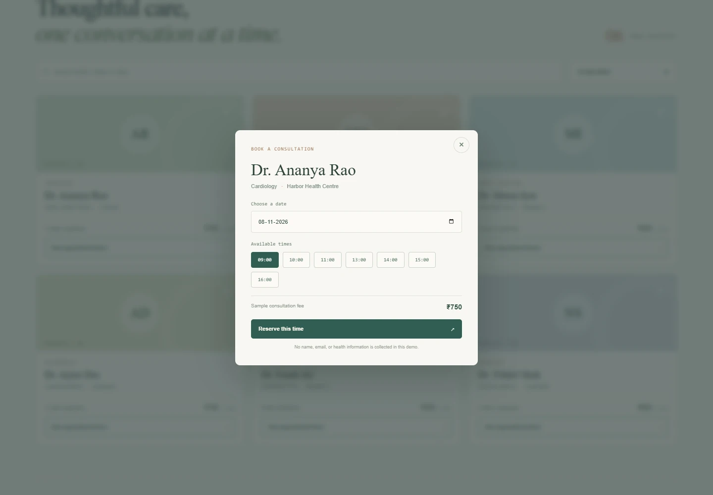
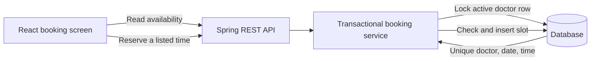

# Careway — Consultation Booking

A fresh rebuild of the archived consultation project as a privacy-conscious appointment scheduling demo. It uses a React 19 + Vite frontend and a Java 21 + Spring Boot 3 REST API with Flyway migrations, sample doctors, filtered specialist search, date/slot availability, booking references, and a PostgreSQL option.

The old packaged app contained a hard-coded database credential and a token authentication bypass. Those archives and their unsafe account/token implementation were removed from the working tree. The rebuilt app deliberately collects no patient name, email, health details, or payment data.

## Run locally

Use Node.js 22.12+ for the frontend and Java 21 with Maven 3.6.3+ for the API. Start the API from `backend/`:

```sh
Windows: `./mvnw.cmd spring-boot:run` (macOS/Linux: `./mvnw spring-boot:run`)
```

Then start the frontend from `frontend/`:

```sh
npm install
npm run dev
```

Open the Vite URL (usually `http://localhost:5173`). The API uses an in-memory H2 database seeded with fictional doctors and listens on port 8080. API health is `/actuator/health`.

### Walk through a booking

Open a fictional specialist's appointment times, choose a date and time, and reserve it. Copy the booking reference into the lookup form. The reserved time will be unavailable when you open the same specialist and date again.



## Verify the booking behavior

From `backend/`, run `./mvnw.cmd test` on Windows or `bash ./mvnw test` on macOS/Linux. The tests use an isolated H2 database. They check that two simultaneous attempts at the same slot produce one committed appointment and one conflict, and that inactive doctors are unavailable on both read and write paths. The frontend build and backend tests run in GitHub Actions. The H2 tests do not establish PostgreSQL concurrency behavior.

## API



- `GET /api/v1/doctors?query=&specialty=` — filter the sample directory
- `GET /api/v1/doctors/{id}/slots?date=YYYY-MM-DD` — list time-slot availability
- `POST /api/v1/appointments` — reserve an available doctor/time
- `GET /api/v1/appointments/{reference}` — retrieve a booking receipt

A booking requires only a doctor ID, a date, and a listed time. The service checks availability in a transaction while locking the doctor row; a database unique constraint protects each doctor/date/time slot. The returned UUID reference can be used to look up the appointment.

## PostgreSQL and deployment

Set `DB_URL`, `DB_USERNAME`, and `DB_PASSWORD` for PostgreSQL. Set `CORS_ORIGIN` to the exact deployed frontend origin. Flyway owns schema changes; Hibernate validates the schema. The frontend API base may be set with `VITE_API_BASE` at build time.

## Boundaries

This is a portfolio demo with fictional listings and no patient data. It is not a hospital, healthcare provider, medical record system, or source of medical advice. Do not use it for actual patient scheduling. A real healthcare deployment needs identity and authorization, private data handling, audit trails, consent and retention rules, abuse protection, and a security/compliance review. The appointment endpoints are intentionally unauthenticated for this data-free demo and should not be exposed as a real service.
